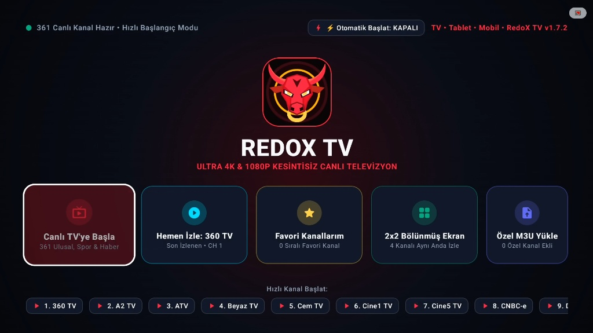
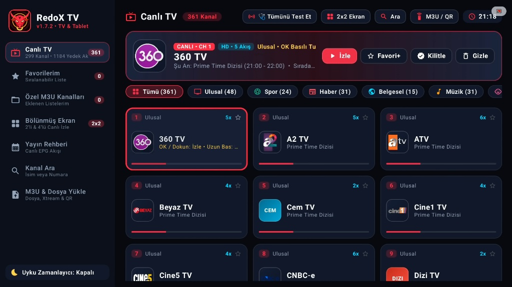
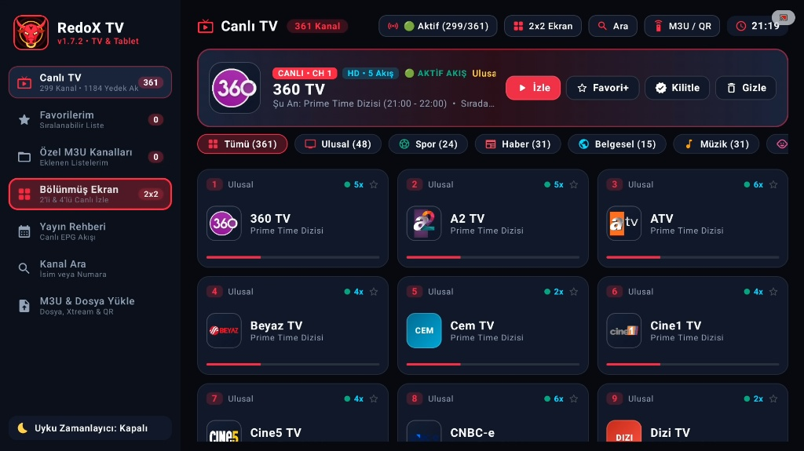
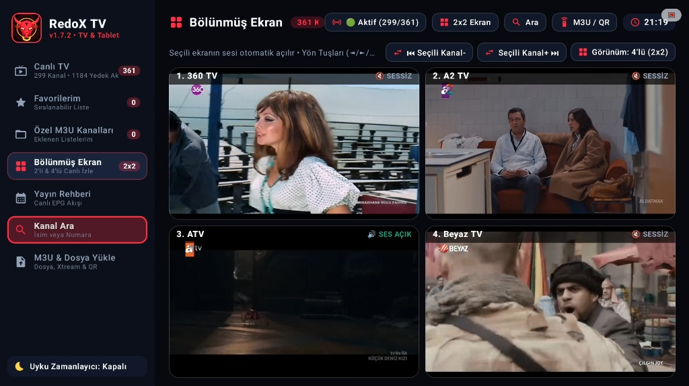
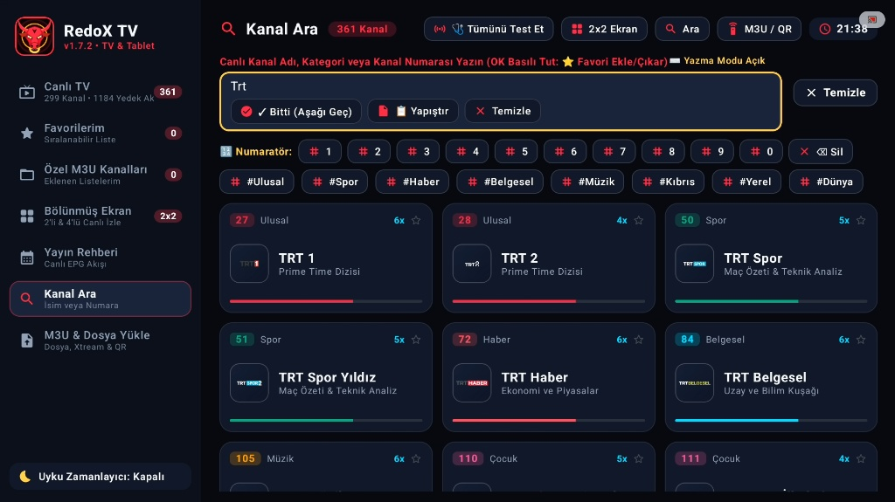
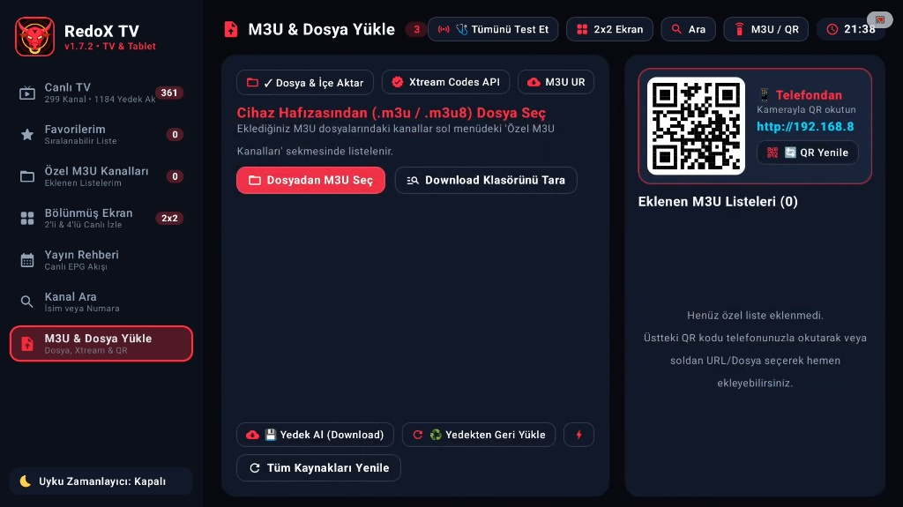

<div align="center">

# 🐂 RedoX TV

**Ultra 4K & 1080p Kesintisiz Canlı Televizyon ve IPTV / M3U Oynatıcı**  
*Android TV • TV Box • Google TV (Chromecast) • Tablet • Mobil*

[](https://github.com/ByReoxXx/Redox-TV/releases)
[](https://github.com/ByReoxXx/Redox-TV)
[](https://github.com/ByReoxXx/Redox-TV)
[](https://github.com/ByReoxXx/Redox-TV/wiki)

**RedoX TV**, hem yeni nesil **Android TV / Google TV / TV Box** cihazlarda hem de eski veya düşük donanımlı televizyon kutularında, tabletlerde ve telefonlarda yüksek performansla çalışmak üzere tasarlanmış **açık kaynaklı** bir canlı televizyon ve M3U/Xtream IPTV oynatıcısıdır.

[📦 **Son Sürümü İndir (Releases)**](https://github.com/ByReoxXx/Redox-TV/releases) · [📖 **Kullanım Kılavuzu (Wiki)**](https://github.com/ByReoxXx/Redox-TV/wiki) · [🐛 **Hata Bildir / Kanal Öner**](https://github.com/ByReoxXx/Redox-TV/issues)

</div>

---

## ✨ Öne Çıkan Özellikler

* 📺 **Hazır Canlı TV Altyapısı ve Çoklu Yedek Akış:** 361 hazır kanal ve **1184+ yedek yayın akışı** (kanal başına 2x–6x alternatif kaynak) sayesinde bir akış kesildiğinde otomatik veya tek tuşla alternatif kaynağa geçiş yapar.
* 🩺 **Canlı Kanal & Akış Sağlık Testi (`Tümünü Test Et`):** Tek tıkla tüm kanalların yayın durumunu tarar, aktif çalışan kanalları (`Aktif 299/361`) yeşil durum göstergesiyle işaretler.
* ⊞ **2'li ve 4'lü Bölünmüş Ekran (2x2 Multi-View):** Aynı anda 2 veya 4 farklı canlı kanalı tek ekranda izleme imkânı sunar. Kumanda yön tuşlarıyla hangi ekranın üzerine gelirseniz **o kanalın sesi otomatik açılır**, diğerleri sessize alınır.
* 📱 **Telefondan QR Kod ile Saniyeler İçinde M3U Yükleme:** TV kumandasıyla uzun URL yazma derdine son verir; ekrandaki yerel QR kodu telefon kameranızla okutarak `.m3u` / `.m3u8` listelerinizi veya bağlantılarınızı anında TV'ye gönderebilirsiniz.
* 🌐 **Çoklu Kaynak Desteği (Dosya, M3U URL & Xtream Codes API):** Cihaz hafızasından `.m3u/.m3u8` seçme, `Download` klasörünü otomatik tarama, uzak M3U URL ekleme ve **Xtream Codes API** hesap girişi.
* 🔢 **Kumanda Dostu Arama & Ekran Numaratörü:** Fiziksel klavyeye ihtiyaç duymadan ekran üstü numaratör (`0-9`), kategori etiketleri (`#Ulusal`, `#Spor`, `#Haber`, `#Belgesel`, `#Müzik`, `#Kıbrıs`, `#Yerel`, `#Dünya`) ve metin arama ile anında kanal bulma.
* 📅 **Canlı Yayın Rehberi (EPG Akışı):** Kanal kartlarında ve önizleme bandında o an yayınlanan programı, saat aralığını ve ilerleme çubuğunu canlı olarak gösterir.
* 🛡️ **Kanal Yönetimi & Kişiselleştirme:** Sıralanabilir **Favoriler** listesi, **Kanal Kilitleme** (ebeveyn kontrolü), istenmeyen kanalları **Gizleme**, **Otomatik Başlatma** modu ve **Uyku Zamanlayıcı**.
* 💾 **Yedekleme ve Geri Yükleme:** Eklediğiniz özel M3U listelerini, favorilerinizi ve ayarlarınızı tek tuşla `Download` klasörüne yedekleyip istediğiniz zaman geri yükleyebilirsiniz.

---

## 🖼️ Ekran Görüntüleri

### 1. Hızlı Başlangıç Ekranı (Splash & Hızlı Erişim)
Uygulama açılışında son izlenen kanala tek tuşla dönme, 2x2 bölünmüş ekrana geçme, özel M3U yükleme ve hızlı kanal başlatma şeridi:


### 2. Canlı TV Ana Ekranı ve Kategori Görünümü
Sol menü navigasyonu, seçili kanal önizleme kartı (`İzle`, `Favori+`, `Kilitle`, `Gizle`), kategori filtreleri ve yedek akış sayısını (`5x`, `6x`) gösteren kanal kartları:


### 3. Canlı Akış Testi ve Aktif Kanal Kontrolü (`Tümünü Test Et`)
Üst bardaki **Tümünü Test Et** aracı ile çalışan kanalların (`Aktif 299/361`) ve aktif yayın kaynaklarının gerçek zamanlı tespiti:


### 4. Bölünmüş Ekran (2'li & 4'lü 2x2 Multi-View)
Aynı anda 4 canlı kanalı izleyin; yön tuşlarıyla seçilen ekranın sesi otomatik olarak açılır (`SES AÇIK`), diğer pencereler sessiz (`SESSİZ`) modda devam eder:


### 5. Gelişmiş Kanal Arama, Ekran Numaratörü ve Hızlı Etiketler
Kumanda ile kolay kullanım için ekran üstü numaratör, `#Spor`, `#Haber`, `#Belgesel` gibi hızlı kategori etiketleri ve EPG destekli arama sonuçları:


### 6. M3U Dosya, Xtream Codes API ve Telefondan QR ile Yükleme
Cihaz hafızasından veya `Download` klasöründen `.m3u / .m3u8` içe aktarma, Xtream Codes API bağlantısı, yerel ağ üzerinden **QR Kod ile telefondan liste gönderme** ve yedekleme araçları:


---

## 🚀 Kurulum Rehberi

### Yöntem 1: GitHub Releases Üzerinden APK İndirme (Önerilen)
1. Bu deponun [**Releases**](https://github.com/ByReoxXx/Redox-TV/releases) sayfasına gidin.
2. En güncel sürümün **Assets** bölümünden `RedoX-TV-vX.X.X-Release.apk` dosyasını indirin.
3. **Android TV / TV Box'a Kurulum:**
   * APK dosyasını USB belleğe atarak veya **X-plore File Manager** / **Send Files to TV** uygulamalarıyla televizyonunuza/kutunuza aktarın.
   * Cihaz ayarlarından *Bilinmeyen Kaynaklardan Uygulama Yükleme* iznini aktif edin ve APK dosyasını kurun.

### Yöntem 2: Kaynak Koddan Derleme (Geliştiriciler İçin)
Projeyi klonlayıp kendi geliştirmelerinizi ekleyebilir veya doğrudan derleyebilirsiniz:

```bash
git clone https://github.com/ByReoxXx/Redox-TV.git
cd Redox-TV
```

---

## 🎮 Kumanda ve Kullanım İpuçları

| İşlem | TV Kumandası / Dokunmatik Kısayolu |
| :--- | :--- |
| **Kanalı Oynat** | Kanal kartı üzerinde **OK** tuşuna basın (veya tek dokunun) |
| **Favorilere Ekle / Çıkar** | Kanal kartı üzerinde **OK tuşuna basılı tutun** (Uzun basma) veya üst karttan **☆ Favori+** seçin |
| **Bölünmüş Ekranda Ses Değiştir** | **Yön tuşları (◀ / ▶ / ▲ / ▼)** ile odaklandığınız pencerenin sesi otomatik açılır |
| **Bölünmüş Ekranda Kanal Değiştir** | Üst bardaki **⏮ Seçili Kanal-** ve **⏭ Seçili Kanal+** butonlarını kullanın |
| **Çalışmayan Kanalları Ayıkla** | Üst menüdeki **🩺 Tümünü Test Et** butonuna basarak aktif akışları tarayın |
| **Telefondan M3U Gönder** | **M3U & Dosya Yükle** sekmesindeki QR kodu telefon kameranızla aynı Wi-Fi ağında okutun |

---

## 📚 Detaylı Wiki Dokümantasyonu

Uygulamanın tüm modülleri için hazırlanan ekran görüntülü rehberlere [**GitHub Wiki**](https://github.com/ByReoxXx/Redox-TV/wiki) sayfasından veya depo içindeki `wiki/` klasöründen ulaşabilirsiniz:

* 🏠 [**Ana Sayfa (Home)**](https://github.com/ByReoxXx/Redox-TV/wiki)
* 📦 [**Kurulum ve İlk Başlangıç**](https://github.com/ByReoxXx/Redox-TV/wiki/Kurulum-ve-Baslangic)
* 📺 [**Özellikler ve Kullanım Rehberi**](https://github.com/ByReoxXx/Redox-TV/wiki/Ozellikler-ve-Kullanim-Rehberi)
* ⊞ [**Bölünmüş Ekran (2x2 Multi-View) Kullanımı**](https://github.com/ByReoxXx/Redox-TV/wiki/Bolunmus-Ekran-MultiView)
* 📡 [**M3U, Xtream Codes ve QR Kod ile Liste Yükleme**](https://github.com/ByReoxXx/Redox-TV/wiki/M3U-Xtream-ve-QR-Yukleme)
* 🎮 [**Kumanda Kısayolları ve Sıkça Sorulan Sorular (SSS)**](https://github.com/ByReoxXx/Redox-TV/wiki/Kumanda-Kisa-Yollari-ve-SSS)

---

## 🤝 Katkıda Bulunma (Contributing)

**RedoX TV** topluluk odaklı, açık kaynaklı bir hobi projesidir. Projeyi daha ileriye taşımak için katkılarınızı bekliyoruz:
* Yeni veya güncel `.m3u` / `.m3u8` ulusal, yerel, haber ve belgesel yayın akışlarını [Issues](https://github.com/ByReoxXx/Redox-TV/issues) veya Pull Request üzerinden paylaşabilirsiniz.
* Kaynak kodları forklayıp yeni özellikler ekleyebilir, yapay zeka araçlarıyla (Gemini, Claude vb.) geliştirmeler yapıp **Pull Request** gönderebilirsiniz.
* Karşılaştığınız hataları cihaz modelinizle (Chromecast, Xiaomi Box, Philips TV vb.) birlikte bildirebilirsiniz.

---

## ⚠️ Yasal Uyarı

Bu uygulama açık kaynaklı bir medya/M3U oynatıcı ve arayüz projesidir. Uygulama içerisinde yer alan varsayılan yayın bağlantıları kamuya açık, ücretsiz yayın yapan ulusal ve yerel televizyon kanallarının açık akışlarından derlenmiştir. Kullanıcıların kendi ekledikleri özel `.m3u` listeleri ve IPTV kaynaklarının kullanım sorumluluğu tamamen kullanıcıya aittir.
